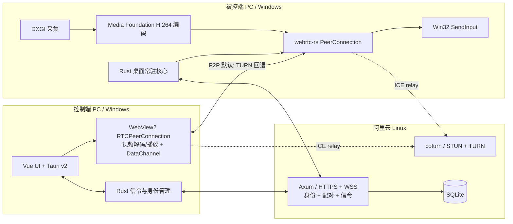

# RemoteHub v1.0 — PC 远程控制软件完整开发与 Agent 交付规范

> 文档性质：产品需求说明（PRD）+ 技术设计（TDD）+ API 约定 + 阶段任务 + 验收标准 + AI Agent 执行说明  
> 版本：v1.0 · 日期：2026-11-21  
> 语言：中文；代码标识符、日志字段、协议字段统一使用英文  
> 状态：**待开发的架构基线，并非已编译/已验证的软件**  
> UI 基准：`../reference/RemoteHub_UI_Concept.png`；该图是外观参考，不能把图中的演示数据当真实数据。

---

## 0. 给 AI Agent 的首要指令（必须先读）

你要为个人用户开发可自行部署的 Windows 桌面远程控制软件 **RemoteHub**。该软件须在双方明确授权的设备之间使用，默认关闭未经授权的远程访问。用户已经批准当前 UI 概念稿；优先实现功能真实可用的简洁客户端。

**强制工程原则：**

1. **先验证最难的技术链路，再完成外围功能。** 必须先跑通 `Windows 画面采集 → H.264 编码 → Rust WebRTC → Windows WebView2 视频播放`；失败时如实记录并执行预定义降级方案，不得伪装完成。
2. 软件只允许用一个面向用户的桌面客户端；不能要求用户分别启动 Sunshine、Moonlight、EasyTier 或额外命令行程序。可使用内嵌 Rust 核心与常驻系统托盘；v1 不依赖第三方运行中的 VPN。
3. 所有 API、数据结构、界面字段必须来源于真实后端，不得将演示设备 ID、延迟、在线状态、编码状态、NAT 类型写死到生产 UI。
4. 所有远程控制操作必须先通过设备配对、会话授权、完整性校验与权限判断；未授权时不得进行采集、发送画面或注入输入。
5. 不得通过关闭 TLS 证书验证、固定公网密钥、全局公开 TURN 密码、自动授权任意设备等方式“完成”网络功能。
6. 每一步提供：改动文件、启动命令、测试证据、风险/欠缺、下一步；不要用假代码/空函数/成功 Toast 冒充实现。
7. 第三方依赖和 SDK 以实现时的官方稳定版本为准；先建立 `Cargo.lock` 与 `pnpm-lock.yaml` 固定可复现版本，不盲目升级。
8. 先交付 Windows 11 x64，随后测试 Windows 10 x64；暂不接入移动端/macOS/Linux 被控端。
9. 对真实云资源的创建、付费操作、云安全组修改、域名 DNS 修改等，必须由所有者提供授权；在缺少凭据时提供脚本与 `.env.example`，不得虚构部署成功。
10. 若某一步受硬件、系统权限或开发环境限制，说明限制并交付可检验的部分成果，不得声称端到端已通过。

**预期终点：** 两台 Windows PC 安装同一个 RemoteHub；首次手动配对；可选择被控设备并连接；优先 ICE 直连；直连不可用时 TURN 中继；展示实时远程画面，可进行鼠标键盘操作，能安全断开、撤销信任、查看连接路径。

---

## 1. 项目背景与最终决策

### 1.1 背景

用户此前使用 Sunshine + Moonlight + EasyTier，感受到的优点是低延迟画面、游戏适用性以及 P2P 组网；主要不便是需要管理多个进程/软件。RemoteHub 的核心目标是**把远控所需功能封装成一个可长期使用的 PC 客户端**，并尽可能降低安装、配置和连接复杂度。

现有云资源：一台位于中国大陆地域的阿里云 Linux 服务器，已知公网出方向带宽约 50 Mbps；服务器具体发行版、CPU、RAM、域名、公网 IP、端口策略和计费模式未知，均需在部署前确认，**不能直接假设**。

### 1.2 竞品借鉴边界

| 参考产品 | 借鉴的理念 | 本项目的具体实现 | 不做的事 |
|---|---|---|---|
| Sunshine | GPU 优先采集/编码，帧率与延迟可控 | DXGI Desktop Duplication + Media Foundation H.264 | 首版不复刻 GameStream/NVENC 专有控制协议 |
| Moonlight | 简洁设备列表、串流会话窗口、低延迟输入 | WebView2 视频接收 + WebRTC DataChannel | 首版不实现 Moonlight 兼容协议/游戏手柄驱动 |
| EasyTier | NAT 穿透、优先直连、失败经节点转发 | ICE/STUN/TURN 标准建连 | 首版不创建 TUN 虚拟网卡或通用 VPN |

源码许可证需独立核对：Sunshine、Moonlight-qt 为 GPL-3.0；EasyTier 仓库声明 LGPL-3.0。**允许学习公开设计思路，但不得不经许可复制源码后宣称独立闭源。** WebRTC Rust 实现及组件也需要依赖许可清单。个人自用与向他人分发时的义务不同，分发前需重新审查全部许可。

### 1.3 设计选择（已确定）

- 客户端管理界面：**Tauri v2 + Vue 3 + TypeScript + Tailwind CSS**。
- 内部核心：**Rust**。UI 用 WebView2，采集、编码、身份和服务器通信不用前端 JS 处理。
- 视频媒体：优先 **H.264 + WebRTC SRTP/RTP**；v1 主要视频流单向（被控端到控制端）。
- 控制消息：**WebRTC DataChannel**；可靠有序通道发送键盘/鼠标按键，尽力而为通道发送高频鼠标移动。
- 穿透：标准 **ICE + STUN + TURN**；P2P 优先，必要时自动使用 TURN relay candidate。
- 信令与设备身份：**Rust Axum + WebSocket + SQLite + Ed25519**。
- TURN：**coturn**，用短期凭据与配额。TLS 由反代提供信令 HTTPS/WSS，TURN TLS 单独配置。
- v1 架构：桌面客户端**单安装包、单运行中主进程**（Tauri 包含 Rust 核心），托盘驻留；不强制额外 sidecar。后续确有独立守护进程需求，再以受控 sidecar/Windows 服务演进。

### 1.4 为什么暂不自研 GameStream / VPN

从零完成屏幕串流、编解码、UDP 打洞、拥塞控制和虚拟网卡会大幅增加开发与兼容成本。WebRTC 已解决 ICE/STUN/TURN、DTLS/SRTP、重传反馈和基础网络自适应等关键底层问题。**本项目可以自己实现产品与业务核心，而不是从零重写全部网络协议。**

> 性能风险提示：基于 WebView2 的 WebRTC 解码路径相对轻量，但未保证能达到 Moonlight 等成熟原生渲染客户端的延迟水平。技术验证阶段必须测量，必要时升级为原生 Direct3D 渲染窗口；不应在验证前承诺 Moonlight 同等级体验。

---

## 2. 产品范围与体验

### 2.1 核心用户流程

1. 安装 RemoteHub → 创建本地长期设备身份（密钥仅保存在本机）。
2. 在本机界面显示设备 ID、网络状态；用户选择是否启用“允许被控”。
3. 在另一台 PC 输入设备 ID → 发送配对请求。
4. 被控端桌面通知确认远程设备名称和短验证码/安全码 → 用户明确同意 → 双端将对方公钥保存到“已信任设备”。
5. 后续从设备列表点击“连接” → 被控端按策略确认或针对指定受信任设备允许无人值守访问。
6. 双端交换受签名保护的会话 SDP 与 ICE candidates → 选用直连或 TURN 中继。
7. 控制端进入会话窗口，画面接收、键鼠操作、状态指标、清晰度/码率选择。
8. 任一端点击断开/撤销授权 → 对端立即停止采集和注入并释放会话资源。

### 2.2 首版功能范围（MVP）

| 优先级 | 功能 | v1 验收口径 |
|---|---|---|
| P0 | Windows PC 控制 Windows PC | 双端同款安装包可互为控制端、被控端 |
| P0 | 设备身份与首次配对 | 需被控端显式同意；支持解除配对 |
| P0 | 远程桌面画面 | 同局域网先实现 720p30，逐步扩展至 1080p60 |
| P0 | 键盘、鼠标、滚轮 | 正常桌面应用可操作，输入位置映射正确 |
| P0 | P2P / TURN | 自动选择路径，并显示所选 candidate pair 的真实状态 |
| P0 | 托盘运行与退出 | 用户主动退出才停止；常驻状态清晰可见 |
| P0 | 安全中断 | 被控端可立即停止远控；网络断开释放输入键状态 |
| P1 | H.264 硬编码与质量档位 | 硬件可用时优先，支持清晰度/码率预设 |
| P1 | 会话状态、RTT、丢包指标 | 从 WebRTC stats 得到数据，不能展示假值 |
| P1 | 自动重连 | 弱网/网络变化后尝试 ICE restart/重建会话 |
| P1 | 开机自启（用户级） | 用户选择开启，适用于已登录用户的托盘程序 |

不属于 v1 的内容：系统音频、手柄映射、文件传输、云盘、群组管理、移动端、跨平台被控、多显示器自由排列、远程电源开机、Windows 登录屏幕控制、UAC 安全桌面、Ctrl+Alt+Del 安全注意序列、虚拟显示器驱动及完全静默无人知晓的远控。

**无人值守的限定：** v1 仅面向“Windows 用户会话已登录，RemoteHub 已运行”的设备。未登录/锁屏后的控制能力不承诺完整可用；在系统登录界面提供远控需要单独的 Windows 服务及会话/权限设计，不能让 Agent 通过提高所有进程权限草率实现。

### 2.3 性能目标（目标，不是默认保证）

| 指标 | 技术验证基线 | 进阶目标 |
|---|---|---|
| 采集与视频 | 720p / 30 FPS 可交互 | 测试机上 1080p / 60 FPS |
| 端到端操作延迟 | 记录分位值与测法 | 在稳定局域网尽量优化至低延迟 |
| 路径选择 | 一次局域网直连；一次 TURN 强制中继 | ICE 正常选优 + 网络变化恢复 |
| 视频码率 | 720p30 约 2–5 Mbps 起步 | 1080p60 约 6–18 Mbps 按场景可调 |
| 内存/CPU | 建立测量基线 | 避免后台无会话时保持高占用 |
| 安全 | 非授权设备无法获得屏幕/键鼠控制 | 会话签名验证、防重放、最小权限 |

硬件与网络差异极大，所有 FPS、延迟与码率最终以 Windows 性能计数器和 WebRTC stats 实测为准。云服务器 50 Mbps 指出网带宽上限条件之一；TURN 同时会受到连接数、包速率和云厂商流量计费影响。

---

## 3. 系统架构与进程模型

### 3.1 组件关系



上图中的两台 PC 均运行相同的 RemoteHub 安装包，只是会话内分别充当控制端和被控端。

### 3.2 客户端职责边界

- **Vue 页面：** 设备列表、配对对话框、设置、连接流程状态、远控浮动工具栏、视频 `<video>` 接收组件；不持有长期私钥，不直接控制 Windows 原生输入 API。
- **Tauri Rust 层：** 本地身份、可信设备列表、信令 WSS 客户端、会话生命周期、与页面通信、后台托盘、配置持久化。
- **Windows 捕获模块：** 枚举物理显示器，使用 DXGI Desktop Duplication 输出 GPU 帧/变化区域；保护内容不可采集，不规避 Windows 保护机制。
- **Windows 编码模块：** 优先使用可用 H.264 Media Foundation MFT，处理 NV12 转换/编码输出、关键帧与码率更新；不可用时明确降级或提示。
- **WebRTC 原生模块：** 被控端使用 `webrtc-rs` 持有 PeerConnection、视频轨和数据通道接收器；媒体以 RTP/H.264 发送。
- **WebRTC 浏览器模块：** 控制端使用 WebView2 RTCPeerConnection 创建视频 `recvonly` 收发器与 DataChannel，发送 ICE/SDP 给 Tauri Rust 信令层。
- **输入模块：** 严格按会话授权过滤，接收消息映射到 Win32 SendInput；对 Windows UAC/UIPI限制如实提示。

### 3.3 视频数据路径

```text
Windows Desktop Duplication (GPU BGRA frames + cursor metadata)
 -> [必要时 GPU/CPU 颜色转换 BGRA->NV12]
 -> Media Foundation H.264 encoder (优先硬件 MFT)
 -> NALU/AU 归一化 + H.264 RTP packetization (RFC 6184)
 -> webrtc-rs SRTP sender
 -> ICE selected candidate pair (P2P or TURN)
 -> WebView2 WebRTC receiver
 -> <video autoplay playsinline> (硬件解码可用时由系统决定)
```

必须检查：H.264 `profile-level-id` 协商；WebView2 支持的配置；SPS/PPS/IDR 初始化；RTP 时间戳 90kHz 时钟；关键帧请求 PLI/FIR；封包 MTU；编码缓冲积压；显示器大小变化后的轨道协商。不能假定“有 H.264 字节流”就能被浏览器 WebRTC 解码。

### 3.4 控制数据路径

```text
用户键鼠操作 (Vue session viewer)
 -> 控制端 DataChannel (event framing + sequence)
 -> DTLS/SCTP over ICE
 -> 被控端 Rust WebRTC datachannel
 -> Session ACL + 输入速率/字段校验
 -> 坐标映射 + Win32 SendInput
```

鼠标位置坐标以**目标物理屏幕像素/归一化坐标**定义，不直接传控制端 CSS 像素。必须考虑 125%/150% DPI、窗口缩放、全屏 letterbox、多个显示器的坐标原点、远端分辨率变化。断开时释放被远端按住的虚拟键。

### 3.5 与 Moonlight 风格的性能分层

- `VideoRenderer` 是抽象接口，v1 为 `WebviewWebRtcRenderer`。
- 如果技术验证证明 WebView2 存在明显额外延迟或不支持目标硬件编解码能力，下一阶段可开发 `NativeD3DRenderer`（可选独立原生会话窗口），但**信令、身份、输入事件和 UI 状态机接口不变**。
- 不要从零写完整 H.264 解码器、NAT 打洞协议或通用 TUN VPN。

---

## 4. 工程目录与命名规范

```text
remotehub/
├── README.md
├── AGENTS.md                         # Agent 工作规则
├── Cargo.toml                       # Rust workspace
├── Cargo.lock
├── pnpm-workspace.yaml
├── package.json                      # frontend scripts
├── pnpm-lock.yaml
├── .gitignore
├── .editorconfig
├── .env.example                      # 只含示例值
├── apps/
│   └── desktop/
│       ├── package.json
│       ├── index.html
│       ├── vite.config.ts
│       ├── tsconfig.json
│       ├── src/
│       │   ├── main.ts
│       │   ├── App.vue
│       │   ├── router/index.ts
│       │   ├── stores/{devices,session,settings}.ts
│       │   ├── pages/{Home,Devices,Connections,Sessions,Settings}.vue
│       │   ├── components/{DeviceCard,NetworkHealth,ConnectDialog,PairDialog}.vue
│       │   ├── session/{SessionViewer,SessionToolbar}.vue
│       │   ├── rtc/{viewerPeer,controlChannel,stats}.ts
│       │   ├── api/{tauriBridge,types}.ts
│       │   └── styles/{tokens,main}.css
│       └── src-tauri/
│           ├── Cargo.toml
│           ├── tauri.conf.json
│           ├── capabilities/default.json
│           ├── src/{main,lib,state,tray,commands}.rs
│           └── icons/
├── crates/
│   ├── hub-common/                  # 错误码、配置、共用类型
│   ├── hub-protocol/                # 帧定义、签名载荷、信令 JSON
│   ├── hub-identity/                # Ed25519、DPAPI、本地信任库
│   ├── hub-signaling-client/        # Axum 服务端连接的 Rust WS 客户端
│   ├── hub-session/                 # 会话状态机、授权、统计
│   ├── hub-transport/               # webrtc-rs 本机 peer 适配器
│   ├── hub-capture-win/             # DXGI Desktop Duplication
│   ├── hub-encoder-win/             # Media Foundation H.264 编码
│   └── hub-input-win/               # Win32 输入事件执行
├── services/
│   └── rendezvous/
│       ├── Cargo.toml
│       ├── src/{main,config,router,auth,ws,pairing,session,turn,db}.rs
│       ├── migrations/
│       └── tests/
├── infra/
│   ├── docker-compose.yml
│   ├── Dockerfile.rendezvous
│   ├── caddy/Caddyfile
│   ├── coturn/turnserver.conf.example
│   ├── env/.env.example
│   └── scripts/{deploy.sh,healthcheck.sh}
├── docs/
│   ├── RemoteHub_完整开发文档_v1.0.md
│   ├── API_contract.md
│   ├── UI_spec.md
│   ├── SECURITY.md
│   ├── TEST_PLAN.md
│   └── ADR/
│       ├── 0001-webrtc-first.md
│       ├── 0002-tauri-one-process.md
│       └── 0003-authenticated-signaling.md
├── tests/
│   ├── integration/
│   └── e2e/
└── reference/
    └── RemoteHub_UI_Concept.png
```

> 目录为工程目标，不要求空文件一次性生成；按阶段实际创建。保持 Rust workspace 模块清晰，并避免循环依赖。`hub-capture-win`、`hub-encoder-win`、`hub-input-win` 通过 Windows 平台条件编译，Linux CI 仅需构建服务端与纯逻辑 crates。

### 4.1 依赖与工具链

- Windows：Rust stable（MSVC target）、Visual Studio C++ Build Tools、WebView2 runtime、Node.js 当前 LTS、pnpm、Git。
- Rust：Tokio、Axum、serde、serde_json、tracing、sqlx(SQLite)、uuid、thiserror、ed25519-dalek（或等价经过审核的实现）、windows crate、webrtc-rs（先固定经过 SPIKE 验证的版本）。
- 前端：Vue 3、TypeScript strict、Vite、Tailwind CSS、Vue Router、Pinia、lucide-vue-next、Vitest、Playwright（UI/E2E）。
- 服务端：Caddy HTTPS/WSS、coturn、Docker Compose、SQLite WAL + 定期备份。
- 首版避免 Electron、C#、大型全家桶 UI 框架、Java、全量数据库服务和强制 TUN 驱动。

注意：`webrtc-rs` 目前处于 0.x API 演进阶段，Agent 应先查看对应标签的官方示例，固定具体 crate 版本与 Cargo.lock，不按过时文章拼凑 API。参考仓库：`https://github.com/webrtc-rs/webrtc`。

---

## 5. 设备身份、配对、权限与信令安全

### 5.1 设备身份

- 每次首次启动在本机生成 **Ed25519 密钥对**；私钥用 Windows DPAPI 保护后存储在用户 AppData 目录；不得上传私钥到云端。
- 展示的 `device_id` 是可读、可复制的公共标识，如 `RH-XXXX-XXXX-XXXX`，根据公钥摘要或服务端不可重复 ID 派生；唯一性校验依赖完整设备公钥和服务端约束，**短 ID 不是认证凭据**。
- 本地数据库记录 `TrustedPeer{device_id, public_key, alias, permissions, paired_at, revoked_at}`；删除信任与撤销授权立即生效。
- 登录服务器使用 nonce challenge + 签名，换取**短期** access token；掉线重新认证；服务器不保存远程桌面视频或输入内容。
- 不要求云端账户密码即可个人自用；但必须限制设备 ID 枚举和配对请求滥用（限流、在线目标校验、配对冷却）。

### 5.2 首次配对协议（状态化）

1. 控制端从设备 ID 发起配对，服务端只转发请求，不直接授予权限。
2. 被控端在前台/托盘显示明确确认框：对方设备名称、时间、双方的指纹短安全码；用户可拒绝。
3. 双端通过签名交换长期公钥 + 一次性 nonce；显示可人工比对的短安全码（双方密钥与 nonce 的摘要），用户确认匹配后形成相互信任绑定。
4. 双端存储完整公钥以及允许的权限。首次配对不授予全局任何来源的自动控制权。
5. 可以在设置中为**指定**可信设备单独启用“在本人已登录时允许无人值守连接”；默认关闭，操作需要二次确认。
6. 被控端随时可撤销访问、终止正在进行的会话、禁止未来发起连接。

### 5.3 会话完整性与服务器不可冒充的设计

仅仅使用 WSS 与 WebRTC DTLS 并不足以防止恶意信令服务器替换 SDP。必须将已配对长期身份与当前会话绑定：

- `offer`/`answer` 携带 `session_id`、双方设备标识、公钥指纹、单次 nonce、过期时间、`sdp_sha256`、`dtls_fingerprint`，由发送方长期私钥对规范化字节序列（推荐 canonical CBOR）签名。
- 接收方须先核对可信公钥与签名，再调用 `setRemoteDescription`。前端无长期私钥；由受限 Tauri Rust command 验证签名并只返回验证结果。
- 签名内容包含消息用途/版本，防止跨协议重放；只接受预期设备、预期 session 的消息；超时与重复消息必须拒绝。
- 服务端可以路由和认证请求，但不能仅凭云端授权代替被控端本地批准。
- TURN 只能转发加密 SRTP/DTLS 数据，不能直接获取视频明文；但服务器仍可能观察元数据/IP/流量大小。

### 5.4 会话权限与被控提示

权限枚举：`view_screen`、`control_keyboard`、`control_mouse`；这些权限独立可撤销。UI 必须显示当前被谁访问、连接类型与“立即停止共享”。**默认没有隐身模式**。

限制：仅允许普通用户会话中的采集和 SendInput，不得绕开 UAC、受保护视频或 Windows 安全桌面。应用获得的权限由当前用户和 Windows 完整性级别决定。对管理员窗口和 Ctrl+Alt+Del 不作首版保证。

---

## 6. API 与事件协议 v1

### 6.1 通用约束

- 所有 HTTPS API 前缀 `/api/v1`；WSS 端点 `/api/v1/signal`。
- Rust 后端和 Tauri 客户端的 JSON 协议使用 `snake_case`；Rust 类型通过 schema 或测试生成 TypeScript 类型，保持严格一致。
- HTTP 统一返回结构：`{ "data": {...}, "request_id": "..." }`；失败：`{ "error": {"code": "...", "message": "...", "retryable": false}, "request_id": "..."}`。
- WebSocket 消息上限（建议 128 KiB，SDP 可能较大）、心跳超时、队列大小、端点限流均配置化，超限拒绝，禁止无限缓存。
- 消息须包含 `protocol_version=1`，未知必填字段或不支持版本明确拒绝。

### 6.2 HTTP 接口清单

| 方法/路径 | 身份验证 | 输入 | 输出/效果 |
|---|---|---|---|
| `GET /api/v1/healthz` | 否 | 无 | 只返回服务存活，不泄漏内部配置 |
| `POST /api/v1/auth/challenge` | 否，限流 | `device_public_key` | `challenge_id, nonce, expires_at` |
| `POST /api/v1/auth/verify` | 设备签名 | `challenge_id, signature, device_name` | `access_token, expires_at, device_id` |
| `GET /api/v1/me` | Bearer token | 无 | 当前设备在线状态和登记信息 |
| `GET /api/v1/turn/credentials?session_id=` | Bearer + 会话获准 | session_id | 有效期短的 `ice_servers` 列表 |
| `GET /api/v1/server-info` | Bearer token | 无 | 协议版本、功能标志、可用 ICE 配置摘要 |

**可选**：`GET /api/v1/devices/{device_id}` 只能返回受限公开资料，且应优先使用经授权的 pairing 流程，避免公开枚举所有在线设备。配对与会话控制以 WebSocket 事件为主，数据库存储仅供服务器内部与设备同步。

### 6.3 WSS envelope

```json
{
  "protocol_version": 1,
  "message_id": "0192c950-0000-7000-8000-000000000001",
  "session_id": "0192c951-0000-7000-8000-000000000001",
  "type": "signal.offer",
  "sender_device_id": "RH-AAAA-BBBB-CCCC",
  "recipient_device_id": "RH-DDDD-EEEE-FFFF",
  "sent_at": "2026-11-21T00:00:00Z",
  "expires_at": "2026-11-21T00:01:00Z",
  "payload": {
    "sdp_type": "offer",
    "sdp": "<WebRTC SDP string>",
    "sdp_sha256": "<base64url digest>",
    "dtls_fingerprint": "<fingerprint from SDP>",
    "nonce": "<one-time random nonce>"
  },
  "signature": "<base64url Ed25519 signature over canonical signed fields>"
}
```

> 示例是形状示意，UUID、日期和签名均非真实可验证数据；实际协议需定义 canonical CBOR 格式、最大长度、签名域与测试向量，不得直接把示例作为可用握手数据。服务器根据 token 强制覆盖/验证 sender，不信任客户端随意填写 sender。

**事件类型：**

- `presence.changed`：设备真实在线状态更新（服务器按心跳/连接判断）
- `pair.request`、`pair.accept`、`pair.reject`、`pair.revoke`：配对与撤销
- `session.invite`、`session.accept`、`session.reject`、`session.end`：会话授权
- `signal.offer`、`signal.answer`、`signal.ice_candidate`、`signal.ice_complete`：WebRTC 协商
- `session.stats`：可选的会话统计回传（尽量只在本机展示，不集中收集敏感数据）
- `heartbeat.ping`、`heartbeat.pong`、`error`：保活与错误

### 6.4 会话状态机

```text
idle -> inviting -> awaiting_consent -> authorized
authorized -> signaling -> ice_checking -> connected_direct
                                  \-----> connected_relay
connected_* -> reconnecting -> connected_* OR failed
任意非 idle 状态 -> closed (拒绝、撤销、断开、超时、退出)
```

状态转换必须由后端单一状态机控制；前端不可以仅凭按钮点击把设备显示成“已连接”。`connected_direct`/`connected_relay` 由**实际选中的 ICE candidate pair** 推导，不因存在 TURN 配置就误判为中继。

### 6.5 控制 DataChannel schema

可靠有序通道：`control.reliable`，传 `key_down`、`key_up`、`mouse_down`、`mouse_up`、`wheel`、`control_ping`、`disconnect`。

尽力而为通道：`control.pointer`，使用 `ordered=false, maxRetransmits=0`，传 `pointer_move`；旧序号事件应丢弃；如果实现复杂，MVP 可先用一个可靠通道，但后续需评估鼠标移动积压。

```json
{
  "v": 1,
  "kind": "pointer_move",
  "seq": 348,
  "session_id": "<uuid>",
  "display_id": "primary",
  "x_norm": 0.5234,
  "y_norm": 0.7821,
  "timestamp_ms": 161234,
  "pressed_buttons": 0
}
```

`x_norm/y_norm` 必须在 `[0,1]` 之间，host 结合目标屏幕的物理边界计算 SendInput 输入；所有字段有长度/范围验证。键盘使用明确的扫描码/虚拟键码规范，处理自动重复、左右修饰键、焦点变化和粘键恢复。默认不捕捉本机全局快捷键，只在聚焦远控窗口时发送输入。

### 6.6 会话中的 TypeScript RTC 接口草案

```ts
export interface ViewerRtcSession {
  start(iceServers: RTCIceServer[], sessionId: string): Promise<void>;
  handleAnswer(sdp: RTCSessionDescriptionInit): Promise<void>;
  addRemoteCandidate(candidate: RTCIceCandidateInit): Promise<void>;
  sendReliableInput(message: ReliableInputEvent): void;
  sendPointerInput(message: PointerInputEvent): void;
  getStats(): Promise<RTCStatsReport>;
  close(): Promise<void>;
}
```

浏览器侧创建 `recvonly` video transceiver；本端生成 offer/ICE，交由 Tauri Rust 信令层代签、发送；接收 answer 后先经 Rust 信任签名校验，再调用 `setRemoteDescription`。媒体处理使用原生 `<video>` 与浏览器 WebRTC API，不在 Vue 更新循环里搬运逐帧图像。

---

## 7. UI / UX 详细实现规范（按确认稿）

### 7.1 视觉基准

参考图：`reference/RemoteHub_UI_Concept.png`。它包含三个界面：**主页/设备看板**、**连接进度弹窗**、**远程会话窗口**。实现需要保持整体布局、深色左导航、浅色内容区、蓝色主强调色、圆角卡片、简洁状态标签；不要求逐像素还原营销海报中的尺寸。窗口里演示的 Linux 设备、假设备 ID、3 个中继节点和毫秒延迟不得硬编码到真实 UI。v1 没有 Linux 客户端时设备列表仅显示 Windows 设备。

颜色/样式建议：

```css
:root {
  --rh-primary: #2563eb;
  --rh-primary-hover: #1d4ed8;
  --rh-sidebar: #142236;
  --rh-background: #f4f7fb;
  --rh-surface: #ffffff;
  --rh-text: #172033;
  --rh-muted: #64748b;
  --rh-border: #e2e8f0;
  --rh-success: #16a34a;
  --rh-warning: #d97706;
  --rh-error: #dc2626;
  --rh-radius: 12px;
}
```

- 使用系统支持的中文 UI 字体（优先“Microsoft YaHei UI”/系统无衬线）；不打包外部商业字体。
- 控件使用 Tailwind CSS + 小型自有组件库 + lucide-vue-next；初期不引入重量级后台管理 UI 套件。
- 主窗口建议初始化 `1080x720` CSS px，最小 `900x600`；支持 DPI 125%/150% 和高分辨率屏。
- 侧栏建议 180–200 px；内容区由网格自适应，避免横向溢出。
- 全部状态带文本与图标，不能仅靠颜色表达在线/错误。
- 把系统错误转成可理解的中文文案，开发诊断信息留到“查看详情”。

### 7.2 主窗口导航结构

| 导航 | 组件 | 内容 |
|---|---|---|
| 首页 | `Home.vue` | 本机 ID/状态、快速连接、最近设备、网络健康和串流概览 |
| 设备 | `Devices.vue` | 已配对设备、别名、在线状态、允许权限、取消授权 |
| 连接 | `Connections.vue` | 输入 ID、配对与连接进度、状态/失败原因 |
| 会话 | `Sessions.vue` | 当前会话、对端设备、传输模式、历史摘要、本机立即断开 |
| 设置 | `Settings.vue` | 服务器地址、网络/中继、画质档位、登录后自启、授权策略、日志导出 |

首页主卡片：本机设备 ID（可复制）、本机是否在线（真实 WS 状态）、被控开关状态；速连输入和按钮；设备列表；当前会话的路由/质量；没有会话时不显示虚假 RTT/FPS。

### 7.3 UI 交互态

```text
DeviceCard: offline | online | pairing_pending | connecting | connected | revoked
ConnectionDialog: requesting | consent_wait | signaling | ice_checking
  | connected_direct | connected_relay | reconnecting | failed | cancelled
SessionToolbar: hidden | visible | disconnected
```

- 设备列表：每行显示头像/设备别名/ID、在线状态、“连接”操作和省略号菜单。
- 网络健康：STUN 与 TURN 可用性通过真实探测得出；NAT 类型不可靠时显示“未知”，不强行展示 NAT1/NAT2。
- 连接弹窗：按真实事件推进交换信令 → ICE 检测 → 直连/中继；TURN 候选可提前收集，UI 不必把 TURN 误解成必须等 P2P 超时才能启动。
- 远控窗口：全屏、画质模式、码率上限、当前路径（P2P/中继）、RTT、断开按钮；v1 不支持的剪贴板/多屏功能不显示成可点击的空操作，可使用禁用状态与“后续版本”说明。
- 被控端：托盘图标和顶部/桌面提示标记“正在被设备 X 远程控制”，可立即停止。
- 无网络、服务端下线、无效 ID、配对拒绝、设备忙、桌面采集失败和编码器不可用分别设计错误状态与重试操作。

### 7.4 前端与后端边界（Tauri IPC）

Tauri Commands（名称暂定，Rust 实际实现需和 TS 严格同名）：

```text
get_local_device_info() -> DeviceInfo
get_local_config() -> AppSettings
save_local_config(patch: SettingsPatch) -> AppSettings
list_trusted_devices() -> TrustedDevice[]
request_pairing(remote_device_id: string) -> PairRequestId
respond_pairing(request_id: string, decision: 'accept'|'reject') -> void
revoke_device(remote_device_id: string) -> void
request_session(remote_device_id: string) -> SessionId
respond_session(session_id: string, decision: 'accept'|'reject') -> void
send_session_signal(session_id: string, message: VerifiedLocalSignal) -> void
verify_remote_signal(session_id: string, envelope: SignedSignal) -> VerificationResult
end_session(session_id: string) -> void
get_connection_stats(session_id: string) -> SessionStats
start_host_access() -> void
stop_host_access() -> void
```

Tauri Events（后端 emit，前端监听并在销毁时移除监听器）：

```text
device-status-changed
pairing-requested
pairing-updated
session-invited
session-state-changed
session-signal-received
session-stats-updated
app-error
```

原则：页面中不保留长期私钥，不直接使用 `window.fetch()` 请求内部敏感 API；信令请求由 Rust 发起/签名/校验，并只通过受限 IPC 暴露所需能力。Tauri `capabilities/default.json` 只启用必须权限；禁止全局执行任意 shell 命令。

### 7.5 远程窗口与快捷键

- 会话窗口独立于首页窗口，使用 Tauri 多窗口或专用 WebView 页面，保持视频渲染与 UI 管理逻辑隔离。
- 鼠标进入远端画面区域时可以捕获鼠标输入，但始终保留可退出焦点/全屏的本机快捷方式；不要永久锁定鼠标。
- 本机快捷键 `Ctrl+Alt+Shift+Q`（可配置）用于结束会话；是否能捕获特定组合受系统限制。
- 远端无法可靠处理安全注意序列、某些系统快捷键及管理员窗口时，明确提示原因。
- 网络采样在 1 秒或 2 秒节流更新，避免 Vue 因高频状态刷新造成渲染抖动。

---

## 8. Windows 原生媒体与输入实施细节

### 8.1 桌面采集 `hub-capture-win`

抽象接口（Rust 伪代码，非可直接编译实现）：

```rust
pub trait DesktopCapture: Send {
    fn enumerate_displays(&self) -> Result<Vec<DisplayInfo>, CaptureError>;
    fn start(&mut self, display_id: DisplayId, fps_cap: u32) -> Result<(), CaptureError>;
    fn next_frame(&mut self) -> Result<Option<CapturedFrame>, CaptureError>;
    fn stop(&mut self);
}
```

- Windows 11 首选 DXGI Desktop Duplication；支持 `IDXGIOutputDuplication::AcquireNextFrame`、失效时重建、dirty regions 和指针叠加。
- v1 采集首选显示器，若发现多屏则在界面列出可选择但如果未完整实现，只启用第一屏。
- 检查黑屏、桌面切换、分辨率改变、显示器休眠、HDR 色彩转换、受保护窗口。
- 采集帧尽量保留 GPU 纹理路径；如不得不进行 CPU BGRA/NV12 转换，记录延迟和内存消耗。
- 禁止在 Vue 中通过 canvas 截屏后再编码，这会增加 IPC 与内存复制开销。

### 8.2 编码 `hub-encoder-win`

```rust
pub trait VideoEncoder: Send {
    fn capabilities(&self) -> EncoderCapabilities;
    fn configure(&mut self, cfg: EncoderConfig) -> Result<(), EncodeError>;
    fn encode(&mut self, frame: CapturedFrame) -> Result<Vec<EncodedAccessUnit>, EncodeError>;
    fn request_keyframe(&mut self) -> Result<(), EncodeError>;
    fn set_bitrate(&mut self, target_bps: u32) -> Result<(), EncodeError>;
    fn stop(&mut self);
}
```

- 通过 Media Foundation 列举 H.264 编码 MFT，优先能够使用 GPU 的实现；硬编码是否支持应以枚举能力和实际编码测量为准，不能因启用了某个选项就标记“硬编码”。
- 校验输出 `Annex B`/`AVCC` 字节布局并转为 webrtc-rs 接受的包形式；实现 RTP/H.264 FU-A/STAP-A 支持或正确复用库内 packetizer。
- 帧率锁在实际采集时间戳上；有背压时优先丢弃积压的旧视频帧而非无界排队。
- 码率模式初始 `office`、`balanced`、`quality`；开始可以是固定码率，按带宽反馈调整属于 P1 优化。
- 不同 GPU 的 MFT 功能与驱动表现不同；**至少测试一台硬件编码可用的 PC**，另测编码能力受限时 UI 的合理失败反馈。

### 8.3 WebRTC 连接 `hub-transport`

- 服务端只交换 SDP、ICE candidates 和会话授权；媒体不经信令服务。
- 控制端 WebView2 JS 创建 `RTCPeerConnection`，`addTransceiver('video',{direction:'recvonly'})`，创建 DataChannels 和本地 offer。
- 被控端 `webrtc-rs` 在验证授权后为视频轨构造 peer connection，协商 H.264，按约定格式写入 RTP samples/packets，并监听 DataChannel。
- ICE 配置包括 STUN 和 TURN（提供短期认证），采用 Trickle ICE，不人为强制拖延 relay candidate 收集。默认由 ICE 选择最合适路径。
- 统计由 `getStats` 获取 selected candidate pair、RTT、丢包、发/收码率、抖动；区分当前路由与“上次连接路由”。
- 切网恢复：检测 disconnected/failed → 受限次数 ICE restart → 完整会话重建 → 给出显式错误状态；初版可中断重连，不承诺完全无感切换。

### 8.4 键盘鼠标 `hub-input-win`

- 依照 Windows `SendInput` 实现；运行在当前已登录用户桌面权限范围内。
- 控制输入与观看权限分开；默认只允许当前活动且授权的会话注入。
- 坐标转换需要支持 DPI scaling、窗口缩放、客户端大小与远端实际 display bounds。
- 被控端要做最大事件速率限制和长度检查，避免异常网络数据持续触发 OS 输入。
- 通道断开/应用退出/会话切换时释放被远端按下的键和鼠标按钮。
- 如系统 UIPI 阻止发送输入，应返回 `INPUT_INTEGRITY_DENIED`，而非静默成功。

---

## 9. 阿里云 Linux 部署规范

### 9.1 服务职责

| 进程 | 用途 | 持久数据 |
|---|---|---|
| `remotehub-rendezvous` | 设备身份、连接状态、配对会话、签名验证、TURN 动态凭据 | SQLite、必要的审计元数据 |
| `coturn` | STUN 与 TURN 网络中继 | 运行配置和短期凭据秘钥，不储存录屏 |
| `Caddy` | HTTPS + WSS 反向代理、证书更新 | 域名证书及配置 |

使用 SQLite WAL；仅 1 台个人服务器时不需要 Redis/PostgreSQL/Kubernetes。身份公钥、配对授权、公钥撤销记录、服务端配置需要持久化；活动 WebSocket 连接和当前 ICE candidate 可仅保存在进程内，重启后由客户端自动重连。

### 9.2 推荐网络端口与安全组

| 端口 | 网络协议 | 目的 | 是否需公网开放 |
|---|---|---|---|
| 80 | TCP | HTTPS 证书 HTTP-01（如使用） | 依据证书策略 |
| 443 | TCP | Caddy HTTPS/WSS 信令 | 是 |
| 3478 | UDP | STUN/TURN UDP | 是 |
| 3478 | TCP | TURN over TCP 备用 | 可选但建议 |
| 5349 | TCP | TURN over TLS | 证书配置完成后开放 |
| 49160–49260 | UDP | TURN relay allocation 端口池示例 | 是；与 coturn 配置一致 |
| 8090 | TCP | Rendezvous 内部监听 | 否；仅 loopback/Docker 内网 |
| 22 | TCP | SSH | 只允许可信管理 IP，使用密钥 |

端口 49160–49260 只是个人使用的初始区间，可能受并发中继与系统资源影响；若新增并发设备，可按测试调整。TURN TLS 的 5349 不能在没有证书时宣称可用。若要让 TURN TLS 监听 443，需要额外独立 IP/端口复用方案，不能与 Caddy 的 HTTPS 直接抢同一监听端口。

### 9.3 建议 DNS 与环境变量

- `hub.example.com` → 阿里云 EIP：Caddy 代理后端；
- `turn.example.com` → 同一 EIP：coturn STUN/TURN；
- 两域名仅为示例，替换成用户实际域名与解析，不写死真实 IP。

`.env.example`（不得提交生产机密）：

```dotenv
RH_ENV=production
RH_BIND=127.0.0.1:8090
RH_PUBLIC_BASE_URL=https://hub.example.com
RH_DATABASE_URL=sqlite:///var/lib/remotehub/remotehub.db
RH_JWT_SIGNING_KEY=<generated-server-secret>
RH_TURN_SECRET=<generated-strong-random-turn-secret>
RH_TURN_HOST=turn.example.com
RH_TURN_PORT=3478
RH_TURN_TLS_PORT=5349
RH_TURN_CREDENTIAL_TTL_SECONDS=600
RH_ALLOWED_PROTOCOL_VERSIONS=1
RH_LOG_LEVEL=info
```

说明：真正的 `.env` 不得提交 git；`RH_TURN_SECRET` 与 coturn 的 `static-auth-secret` **必须一致**。实际实现中环境变量名称统一后写入代码与文档，生产敏感值使用 root 限读文件、Docker secrets 或受控环境变量。

### 9.4 TURN 配置关键项

`infra/coturn/turnserver.conf.example`：

```ini
listening-port=3478
realm=turn.example.com
server-name=turn.example.com
fingerprint
use-auth-secret
static-auth-secret=REPLACE_WITH_STRONG_SECRET
min-port=49160
max-port=49260
no-cli
no-loopback-peers
no-multicast-peers
user-quota=12
total-quota=64
```

- `static-auth-secret` 只允许服务器读取。生产使用模板渲染或 secrets 注入，禁止在仓库里保存真实值。
- 在云主机有内网 IP + EIP 映射时根据实际网络设置 `external-ip=<public>/<private>`；不得假设 `listening-ip`/`external-ip` 的值固定不变。
- 需要 TURN TLS 时再配置 `tls-listening-port=5349`、有效 `cert/pkey` 与对应开放端口；证书更新须有可执行维护流程。
- 可按云主机带宽增加 `bps-capacity`、`max-bps`、allocation 数限制，但数值必须根据实测和 coturn 版本的参数单位设置。
- 启动后使用独立 STUN/TURN 测试工具与 WebRTC 测试场景验证 relay candidate，不以“进程在线”代替中继可用。

### 9.5 部署步骤与验收

1. 在本地或 CI 构建 Linux x86_64 `remotehub-rendezvous`，生成 Docker 镜像和 SBOM/依赖许可清单。
2. 准备真实域名、阿里云安全组规则及防火墙端口；不能借用未知已有服务的 443 端口。
3. 为信令启用 HTTPS/WSS；检查 WebSocket 升级、断连与心跳。
4. 部署 coturn，使用临时凭据测试 UDP/（如支持则 TLS）relay candidate；检查服务器外部 IP 宣告。
5. 部署 rendezvous，执行 SQL migration，存活检查、设备双向认证、配对、会话授权、TURN 凭据发放测试。
6. 用两台外网 Windows PC 做 STUN 直连/强制 relay/一端网络切换实测。
7. 配置数据库与环境文件备份、日志轮换、磁盘/带宽告警；避免打开转发滥用。

**强制 relay 测试方法：** 在测试构建里使用 `iceTransportPolicy: 'relay'` 只为验证 TURN 工作，不把它作为生产默认值；禁用直连后必须真实建立会话并传输画面及键鼠，而非只获取 relay candidate。

### 9.6 阿里云成本与风险

P2P 成功时实时媒体不经过云服务器；TURN 中继时视频从被控端进入云端，再由云端发给控制端，带宽与流量计费受实际拓扑影响。50 Mbps 出方向带宽通常可以覆盖个人的几路中等码率会话，但**不构成具体并发保证**。上线前需检查阿里云公网出流量/固定带宽计费类型、ACL 和可能的备案/域名要求，不在缺少真实条件时编造费用。

---

## 10. 数据模型与配置

### 10.1 服务端 SQLite 表

```text
devices(
  device_id TEXT PRIMARY KEY,
  public_key BLOB UNIQUE NOT NULL,
  display_name TEXT NOT NULL,
  created_at INTEGER NOT NULL,
  last_seen_at INTEGER,
  disabled_at INTEGER
)

pairings(
  pair_id TEXT PRIMARY KEY,
  requester_device_id TEXT NOT NULL,
  target_device_id TEXT NOT NULL,
  requester_public_key BLOB NOT NULL,
  target_public_key BLOB NOT NULL,
  accepted_at INTEGER,
  revoked_at INTEGER,
  permissions_json TEXT NOT NULL
)

audit_events(
  event_id TEXT PRIMARY KEY,
  device_id TEXT NOT NULL,
  event_type TEXT NOT NULL,
  peer_device_id TEXT,
  session_id TEXT,
  occurred_at INTEGER NOT NULL,
  result_code TEXT NOT NULL
)
```

表为逻辑设计，实际 SQL migration 必须补足索引、FOREIGN KEY、时间精度、唯一约束、有效配对状态校验。对于个人部署可选保留轻量的安全审计元数据，不得记录远程画面、输入内容或长期 TURN 密码。

### 10.2 本地配置

本地 AppData 内保存：

```json
{
  "schema_version": 1,
  "rendezvous_url": "https://hub.example.com",
  "host_access_enabled": false,
  "allow_unattended_for_specific_peers": false,
  "start_at_login": false,
  "preferred_quality": "balanced",
  "preferred_codec": "h264",
  "show_remote_control_indicator": true,
  "telemetry_enabled": false
}
```

`allow_unattended_for_specific_peers` 只是全局功能开关，实际授权仍需 TrustedPeer 单独的允许权限。`rendezvous_url` 修改需重新验证 TLS/服务器身份和会话安全策略。私钥不可存入普通 JSON 配置。

### 10.3 错误码规范

| 错误码 | 中文说明 | 用户操作 |
|---|---|---|
| `SERVER_UNAVAILABLE` | 无法连接信令服务器 | 检查网络/服务器地址后重试 |
| `AUTH_SIGNATURE_INVALID` | 本机身份校验失败 | 查看本地身份状态，拒绝连接 |
| `DEVICE_NOT_FOUND` | 设备不存在或不可访问 | 确认设备 ID |
| `DEVICE_OFFLINE` | 对方设备不在线 | 等待上线 |
| `PAIRING_REQUIRED` | 尚未配对 | 向对方发送配对请求 |
| `PAIRING_REJECTED` | 对方拒绝配对 | 不自动继续尝试 |
| `CONSENT_DENIED` | 对方拒绝会话 | 中止连接 |
| `SESSION_ALREADY_ACTIVE` | 对方已有不兼容会话 | 提示稍后再连接 |
| `SDP_SIGNATURE_INVALID` | 对方会话身份签名失败 | 立即拒绝，标记安全告警 |
| `ICE_CONNECT_TIMEOUT` | 网络建连超时 | 查看 UDP/TURN 可用性 |
| `TURN_UNAVAILABLE` | 中继服务不可用 | 输出诊断，不伪报直连 |
| `CAPTURE_UNAVAILABLE` | 无法采集此桌面 | 检查已登录用户桌面/显卡驱动 |
| `ENCODER_UNSUPPORTED` | 无可用 H.264 编码器 | 尝试兼容模式或明确提示 |
| `INPUT_INTEGRITY_DENIED` | Windows 权限阻止输入 | 提示权限限制 |
| `PERMISSION_REVOKED` | 对方取消访问授权 | 立即断开并释放资源 |

错误码需统一定义在 `hub-common`，服务器与客户端均使用相同语义；所有错误包含 `retryable`，区别永久失败与网络暂时失败。

---

## 11. 开发阶段、任务拆解与交付物

所有阶段按依赖顺序执行。每个任务必须有可复现实验步骤/测试记录。**禁止把 P0 视频验证延期到全部 UI 完成之后。**

### Phase 0 — 技术可行性关卡（阻塞其他复杂工作）

| ID | 任务 | 可检验产物 |
|---|---|---|
| `P0-01` | 初始化 Rust/Vue/Tauri 测试工程并确认 Windows Build Tools 与 WebView2 | 可启动最小 Tauri 窗口，记录环境版本 |
| `P0-02` | Windows DXGI 采集主屏，输出可观察帧和时间戳 | 截帧样本/采集 FPS/异常处理测试 |
| `P0-03` | Media Foundation 生成浏览器能解码的 H.264 | 720p30 H.264 输出 + profile/IDR/SPS/PPS 测试 |
| `P0-04` | `webrtc-rs` 向 WebView2 发送视频轨 | 双端在局域网播放持续视频的录屏与 stats |
| `P0-05` | WebRTC DataChannel 传输模拟鼠标事件 | 控制端发送、被控端接收日志/有序性测试 |
| `P0-06` | coturn 强制 relay 传输同一视频轨 | `selectedCandidatePair` 为 relay 的证据 |
| `P0-07` | 技术决策记录（ADR） | 成功/失败、性能统计与备选方案决议 |

**Phase 0 退出条件：** 不要求 UI 精致，但最少要在两台真实 Windows PC 上完成连续视频传输 + 控制消息发送，并证明 TURN 路径可用。任何未通过的测试都应列成阻塞项，而不是将任务标记完成。

**Phase 0 降级路径：**

1. H.264 硬编码不可用：暂用 Media Foundation 软件编码完成 720p30 的协议闭环，同时保留统一 `VideoEncoder` 接口；硬件目标标记未完成。
2. `webrtc-rs` 与 WebView2 H.264 互通困难：先使用 `webrtc-rs` 官方 H26x 测试流、明确定位 SDP/packetizer/decoder 问题，避免重复替换架构。
3. WebView2 解码延迟不可接受：保持 WebRTC/SDP/DataChannel/信令不变，单独评估 Direct3D 原生渲染的方案，并新增 ADR；不得在未测试前无条件切换为复杂自建协议。
4. TURN 中继失败：优先排查 coturn external-ip、UDP 端口池、安全组和临时凭据，而非回退到未加密的自研 TCP 中继。

### Phase 1 — 工程骨架与 UI（可先用 mock，但上线前必须移除）

| ID | 任务 | 验收 |
|---|---|---|
| `P1-01` | 建立 Cargo + pnpm monorepo、格式化/检查脚本 | Windows `cargo check`, `pnpm build` 通过 |
| `P1-02` | 根据 UI 概念图实现主窗口和侧栏 | 首页、设备、连接、会话、设置可跳转 |
| `P1-03` | 实现设备卡片、连接弹窗、会话浮动工具栏 | 多状态 UI 可交互、截图可审查 |
| `P1-04` | 实现 Pinia store、Tauri IPC API | Mock/真实 API 通过统一接口切换 |
| `P1-05` | 引入中文错误码映射、空状态、加载状态 | 错误有可读反馈，不存在无效按钮 |
| `P1-06` | 托盘驻留、关闭窗口行为、显式退出菜单 | 关闭主窗口不影响用户选择的后台运行；退出清理资源 |

### Phase 2 — 身份、配对与服务器

| ID | 任务 | 验收 |
|---|---|---|
| `P2-01` | 本地 Ed25519 身份创建、DPAPI 保存、重启恢复 | 设备 ID 稳定、私钥无法从日志/API 导出 |
| `P2-02` | Axum API + SQLite migrations + WebSocket | healthz/双向登录/心跳测试 |
| `P2-03` | 设备在线状态和限流 | 断线超时更新在线状态；重连可恢复 |
| `P2-04` | 首次配对请求、批准、拒绝、撤销 | 被控端未同意前无法控制；撤销立即失效 |
| `P2-05` | 受签名 SDP/offer/answer 信令 | 篡改 SDP、替换设备密钥、重放均被拒绝 |
| `P2-06` | Session ACL、主动断开、超时清理 | 无授权不得建立媒体或输入通道 |

### Phase 3 — 远控媒体和输入整合

| ID | 任务 | 验收 |
|---|---|---|
| `P3-01` | DXGI + H.264 + webrtc-rs 嵌入 Tauri Rust 核心 | 无需启动外部 Sunshine 进程即可分享画面 |
| `P3-02` | WebView2 会话窗口收流与显示 | 主屏 720p30 连续可看、画面可缩放 |
| `P3-03` | DataChannel 键鼠注入 | 点击、输入、拖拽、滚轮在常规桌面可操作 |
| `P3-04` | 多 DPI、窗口尺寸变更处理 | 100/125/150% 缩放条件点击定位测试 |
| `P3-05` | 会话断开与资源回收 | 无持续 GPU 编码线程、无未释放按键 |
| `P3-06` | 会话指示与本地一键停止 | 被控端可终止且拒绝后续该会话控制 |

### Phase 4 — 公网连接与中继

| ID | 任务 | 验收 |
|---|---|---|
| `P4-01` | ICE/STUN 直连与公网网络测试 | 至少一种不同 ISP/网络环境建立 P2P |
| `P4-02` | TURN 短期凭据生成与 coturn | 凭据能连接，过期/无授权不能新分配 |
| `P4-03` | 失败自动选择中继 | 直连阻断时成功 relay 并传视频和控制 |
| `P4-04` | 实际 ICE candidate pair 状态显示 | 明确展示当前 P2P vs relay，不显示模拟值 |
| `P4-05` | 网络切换/断网恢复 | 有界重试，失败时明确退出，成功后恢复 |
| `P4-06` | 带宽与滥用保护 | TURN 配额、请求限流、日志敏感字段脱敏 |

### Phase 5 — 画质与可用性优化

| ID | 任务 | 验收 |
|---|---|---|
| `P5-01` | H.264 硬件编码优先 | 输出真实编码器名称/类别与性能基线 |
| `P5-02` | 1080p60 性能优化 | 在测试 GPU 上实测 FPS、延迟与 CPU/GPU 占用 |
| `P5-03` | 带宽/帧率统计与画质预设 | 设置改变有实际编码器/会话行为 |
| `P5-04` | 弱网优化、帧丢弃、关键帧处理 | 丢包/抖动环境可恢复，不持续堆积延迟 |
| `P5-05` | 用户级开机自启选项 | 显式启用/关闭、重启系统用户登录后生效 |

### Phase 6 — 安全、发布与维护

| ID | 任务 | 验收 |
|---|---|---|
| `P6-01` | 威胁建模与负向测试 | 未配对/撤销/重放/伪造信令均阻断 |
| `P6-02` | 客户端 NSIS 或 MSI 安装包 | 干净 Windows 11/10 可安装并卸载 |
| `P6-03` | 服务端部署文档、Docker Compose、备份 | 可在干净 Linux 服务器上按步骤复现 |
| `P6-04` | 审计与隐私 | 不上传/留存桌面内容；敏感日志脱敏 |
| `P6-05` | E2E 测试报告与已知限制 | 验收报告、构建版本、测试机器信息齐全 |

---

## 12. 测试矩阵与量化验收

### 12.1 连接场景

| 场景 ID | 网络环境 | 预期结果 |
|---|---|---|
| `NET-01` | 两台 PC 同局域网 | 直连，视频/输入正常，候选对非 relay |
| `NET-02` | 不同公网网络，NAT 条件允许 | 优先尝试直连，成功则显示 P2P |
| `NET-03` | 屏蔽/禁止主机候选直连，TURN 可达 | 通过 TURN 中继，UI 显示中继 |
| `NET-04` | TURN 不可达，P2P 可达 | 直连不受影响，并提示中继不可用 |
| `NET-05` | TURN 不可达且 P2P 失败 | 清晰报错/有界重试，不能假连接 |
| `NET-06` | 一端移动热点/Wi-Fi切换 | 尝试 ICE restart，不能恢复时结束会话 |
| `NET-07` | 信令服务器重启 | 在线状态恢复，失败会话安全退出/可重连 |
| `NET-08` | 多会话请求同一被控 PC | 按“单活动控制会话”限制拒绝冲突，避免混乱输入 |

注意：P2P 穿透是网络条件相关的，**无法保证每一类 NAT 都能打洞成功**；正确性体现为失败时能安全、自动地使用中继，且路径标识真实。

### 12.2 安全场景

```text
SEC-01 非配对设备直接发送 session.invite -> 服务端/被控端拒绝
SEC-02 配对请求未被接收方批准 -> 不产生持久信任
SEC-03 替换 answer.sdp 内容但不重签 -> 签名验证失败
SEC-04 替换设备公钥 -> 无法匹配本地信任条目
SEC-05 发送过期/重复 message_id -> 拒绝或幂等处理
SEC-06 删除受信任设备 -> 立即终止会话且不能自动重连
SEC-07 未授权用户尝试获取 TURN 凭据 -> 拒绝
SEC-08 TURN 凭据过期/伪造 -> 新的 allocate 失败
SEC-09 被控端点击停止 -> 立即停止编码和输入通道
SEC-10 客户端退出/断网 -> 按键状态释放/会话锁及时清理
SEC-11 日志检查 -> 不包含私钥、access token、TURN 密码或原始输入数据
```

### 12.3 媒体/输入场景

```text
MEDIA-01 720p30 的持续输出，视频可见并记录真实 FPS
MEDIA-02 1080p60 在指定支持的 GPU 上的实测和瓶颈记录
MEDIA-03 远端显示器分辨率变更后可恢复画面/正确报错
MEDIA-04 压测 20 分钟，监测 CPU/GPU/内存/延迟/帧丢失趋势
MEDIA-05 键盘字母、数字、左右修饰键、粘贴限制说明
MEDIA-06 鼠标左/右键、拖拽、滚轮，窗口缩放坐标准确
MEDIA-07 DPI 100%、125%、150%，远端点击校准
MEDIA-08 切出会话窗口时应避免误发远端输入
MEDIA-09 Windows UAC/安全桌面限制正常提示，不越权
```

### 12.4 测试证明标准

Agent 每次报告应包含：软件版本/commit、OS 版本、GPU 型号与驱动、网络拓扑、分辨率与帧率、测试持续时间、客户端日志要点、WebRTC candidate pair 类型及截图。自动化测试可在 CI 中运行；真实 GPU、真实 NAT 和安装程序运行需有实际 Windows 主机，不能用 Linux 上通过单元测试来替代。

---

## 13. 代码质量、CI 与安全约束

### 13.1 质量门槛

```text
Rust:   cargo fmt --all -- --check
        cargo clippy --workspace --all-targets -- -D warnings
        cargo test --workspace
        cargo audit                   # 有条件时执行并记录风险
Vue:    pnpm lint
        pnpm typecheck
        pnpm test
        pnpm build
Release: Windows x64 tauri build + Linux server build
```

上述脚本须由 Agent 在 `package.json` / workspace 配置中真实创建，未配置时不能假装可执行。硬件/Windows 专属测试只能在适当的 Windows runner 或测试机运行，Linux CI 不需要强行编译全部 Windows crate。

### 13.2 日志与隐私

- `tracing` 结构化日志，记录 `session_id`、阶段耗时、错误码、selected pair 类型、码率/FPS 等**有限诊断字段**。
- 永远脱敏 access token、TURN password、私钥、完整 SDP（默认）、用户输入内容、远程视频帧。
- 默认本地诊断，不收集云端遥测；如要上报错误，必须有显式授权开关。
- 日志轮换、保留期可配置，默认短期保留并提供“清理日志”操作。

### 13.3 依赖与许可

- 维护 `THIRD_PARTY_NOTICES.md`/SBOM。
- Sunshine、Moonlight、EasyTier 只作为公开技术参考，不复制或改写源码到此项目；若未来引入，先做许可证和派生作品分析。
- 要尊重 H.264 编码相关的操作系统/设备/分发限制；本工程以 Windows 系统提供的媒体接口为优先，而不是附带不明来源的编码器二进制。
- 不使用任意脚本远程执行功能，不引入隐藏控制、凭据读取、浏览器密码获取等行为。

---

## 14. Agent 开发工作流（可直接执行）

### 14.1 第一次启动的操作顺序

1. 阅读 `AGENTS.md`、本文与 UI 参考图。
2. 汇报硬件/OS/SDK/网络/阿里云信息缺口，但**不要因为没有云账号就阻塞本地技术 Spike**。
3. 建立 monorepo 和任务清单 `TASKS.md`（状态：`todo | doing | blocked | done`）。
4. 优先进行 Phase 0：DXGI → MF H.264 → webrtc-rs → WebView2，完成真实本机/双机验证。
5. 为每个可运行模块创建最小测试/演示命令与 README；记录所有失败和可复现步骤。
6. Phase 0 通过后，按 Phase 1–6 实施；每阶段把 UI Mock 换成真实 API，并补充安全测试。
7. 交付 release 编译产物、Docker 服务配置、测试记录以及未完成清单；不要把一个看起来完整的 UI 当作完成远控软件。

### 14.2 单个任务完成标准（Definition of Done）

```text
[ ] 代码实现完整，真实调用底层 API
[ ] 新增/改动接口与本文约定一致，必要时先记录 ADR
[ ] 编译通过，依赖锁文件更新且可复现
[ ] 单元/集成/E2E 测试按任务要求通过
[ ] 没有硬编码的成功状态、密钥、服务器公网 IP、假的质量数字
[ ] 不扩大不必要的系统或 Tauri 权限
[ ] 提供运行截图/日志/测试证据
[ ] TASKS.md 标记状态，并列出剩余风险
```

### 14.3 每轮 Agent 提交格式

```markdown
## 本轮完成
- [P0-03] ...

## 修改文件
- path/to/file.rs — ...

## 实际执行命令与结果
- `cargo test ...` — PASS/FAIL（附摘要）
- Windows 实机验证：未执行/已执行（具体原因和结果）

## 阻塞及技术决策
- ...

## 下一轮优先任务
- [P0-04] ...
```

### 14.4 禁止事项

- 禁止把“编译成功”误称为“已经完成两机远控”。
- 禁止仅因 WebRTC 创建成功就标记视频传输成功；必须看到视频帧及证明真实媒体统计。
- 禁止在未经授权的被控设备上静默开启共享。
- 禁止默认把 TURN 配置为匿名开放；不能写死长期用户名密码到客户端。
- 禁止为修复安全桌面限制要求所有进程始终以管理员权限运行。
- 禁止直接删除测试失败记录、忽略错误或弱化身份校验来使演示成功。
- 禁止从 Sunshine/Moonlight/EasyTier 复制源文件后遗漏许可证义务。

---

## 15. 待确认环境变量（可推迟，不阻塞初始开发）

| 信息 | 当前状态 | 用途 |
|---|---|---|
| Windows 版本 | 尚无设备详情 | 控制端/被控端实机兼容 |
| GPU 型号（NVIDIA/AMD/Intel） | 未提供 | 测试 MFT 硬编码支持 |
| 阿里云服务器 CPU/RAM/Linux 发行版 | 只知 Linux | 确定 Docker 镜像与容量 |
| 阿里云公网 IP/域名 | 未提供 | WSS 与 coturn 真实配置 |
| 是否允许开放 UDP 3478 与 relay 端口 | 未确认 | 影响 TURN relay 可用性 |
| 有无 Windows 10 测试机 | 未确认 | 兼容性回归 |
| 是否要求系统登录前无人值守 | **v1 不支持** | 后续是否增加 Windows 服务 |
| 音频/手柄/文件传输是否强制 | **v1 不包含** | 后续路线图 |

Agent 遇到未知条件时优先使用可替换配置、Mock 测试服务器和本地 dev 模式；不得将猜测当作用户最终决定。

---

## 16. 官方技术参考（供 Agent 查询最新文档）

1. Tauri v2 Windows 构建条件：https://v2.tauri.app/start/prerequisites/
2. Tauri v2 sidecar（未来若需要独立守护进程）：https://v2.tauri.app/develop/sidecar/
3. WebRTC Rust（含 H26x 演示与最新 API）：https://github.com/webrtc-rs/webrtc
4. WebRTC ICE candidate 说明：https://developer.mozilla.org/en-US/docs/Web/API/WebRTC_API/Connectivity
5. coturn 官方配置和临时凭据：https://github.com/coturn/coturn/wiki/turnserver
6. Windows Desktop Duplication：https://learn.microsoft.com/en-us/windows-hardware/drivers/display/desktop-duplication-api
7. Media Foundation Hardware MFT：https://learn.microsoft.com/en-us/windows/win32/medfound/hardware-mfts
8. Media Foundation H.264 视频编码：https://learn.microsoft.com/en-us/windows/win32/medfound/h-264-video-encoder
9. Win32 SendInput 和 UIPI：https://learn.microsoft.com/en-us/windows/win32/api/winuser/nf-winuser-sendinput
10. Sunshine 项目：https://github.com/SunshineStream/Sunshine
11. Moonlight Qt 项目：https://github.com/moonlight-stream/moonlight-qt
12. EasyTier 项目：https://github.com/EasyTier/EasyTier

**执行提示：** 该文档是“应实现的系统规范”，不是已实现项目。建议先让 Agent 按 Phase 0 做关键媒体技术验证；只有验证成功后，再对完整项目排期和大规模代码生成。
